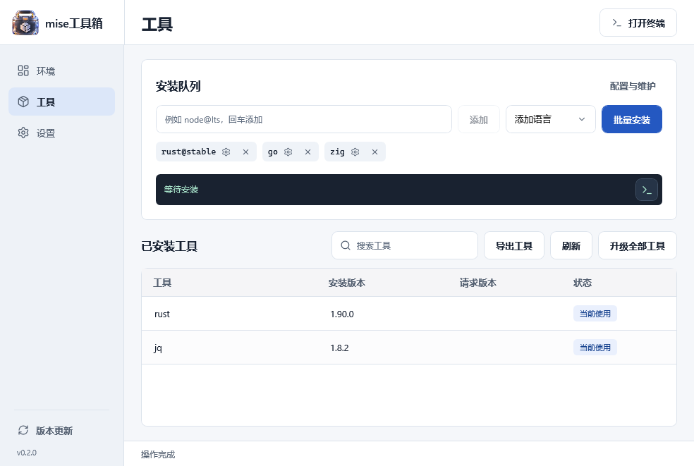
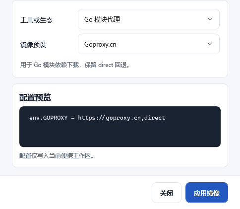
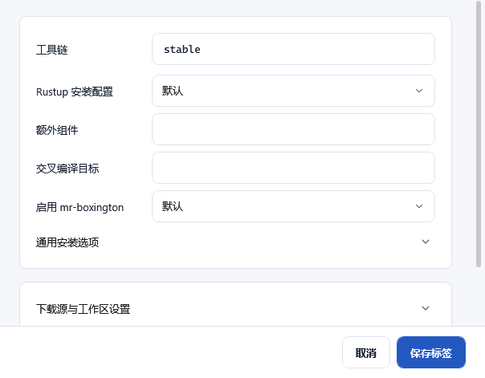
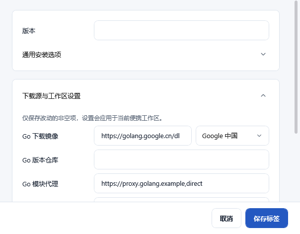
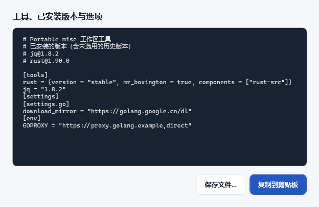

# mise工具箱 · Mise Toolbox

适用于 Windows 11 的 mise 桌面工具。可以批量安装和更新开发工具，为不同语言设置版本、安装选项和镜像，并在换机后从原有目录恢复环境。

**下载 v0.4.1**：[Windows x64](https://github.com/ca-x/portable-mise/releases/download/v0.4.1/PortableMise-v0.4.1-win-x64.exe) · [Windows ARM64](https://github.com/ca-x/portable-mise/releases/download/v0.4.1/PortableMise-v0.4.1-win-arm64.exe) · [发布说明与校验文件](https://github.com/ca-x/portable-mise/releases/tag/v0.4.1)

按设备架构下载单个 EXE。运行需要 [.NET 10 Desktop Runtime](https://dotnet.microsoft.com/zh-cn/download/dotnet/10.0)。



## 使用

1. 将 EXE 放到准备长期保留的目录。首次启动选择 mise、工具目录及代理，点击“安装 mise”。
2. 平时点击“更新环境”，分别执行 `mise self-update --yes` 和 `mise upgrade --yes`。工具页输入 `node@lts`、`python@3.13` 等规格后回车加入队列，可移除或点击标签齿轮编辑，再点击“批量安装”。安装中可以继续排队，两行状态实时显示当前批次和最新输出，终端图标可打开完整日志。
3. 重装系统或移动整个工作目录后，启动同一个程序，点击“恢复环境”。程序会重新登记当前用户的 mise 环境变量、PATH 和 shims，保留已有工具和全局配置。

已使用较早版本时，可以在「版本更新」点击「检查新版本」，再点击「下载安装并重启」。也可以在设置的「自动更新」中开启「桌面程序」。更新包来自 GitHub Releases 并校验 SHA256，更新时保留旧 EXE 和现有配置、工具数据。

界面内嵌简体中文和英文，安装时默认跟随 Windows。可在设置中选择语言并保存，重启后生效。

## 工具选项与维护

“添加语言”包含 mise 官方核心语言目录。标签齿轮根据语言显示对应的版本、安装选项与可编辑的工作区镜像。Rust 可选择工具链、组件、目标和 mr-boxington，启用后会把配套工具加入队列。Rustup 下载地址与 Cargo 依赖镜像独立保存。Go 本体下载支持官方默认站、Google 中国站及自定义地址；`GOPROXY` 单独填写，保留逗号、竖线回退规则和 `direct` 参数。

在工具页点击「语言镜像」，或从工具标签的齿轮进入对应语言的镜像目录。选定生态与镜像后可先预览再应用。Go 模块、npm、pip 等可由 mise 注入的设置保存在当前工作区；外部终端可通过 `mise exec` 或激活 mise 使用这些设置。Maven、NuGet 等从工作区生成独立配置文件，应用后对话框显示适用的客户端参数或配置方式。镜像地址参考 [chsrc 语言配方](https://github.com/RubyMetric/chsrc/tree/03dd727e76b3510fc0f26f74c5cb1ec13702b0e0/src/recipe/lang)。

工具配置与维护可打开 mise 和便携 Cargo 配置文件，提供原生工具选项、安装前后钩子和软件包配置示例。WinGet 声明式软件包及当前用户的工具清理先预览再执行。共享系统工具仅提供清理预览。PowerShell 激活命令可复制。

“导出工具”预览可复制或保存为 TOML。导出保留工作区的工具声明、选项和已知镜像设置，附完整已安装版本清单；已安装但未被声明的工具也会加入配置。Cargo 镜像另以可复制的 Cargo 配置片段附在文件里。

<details>
<summary>查看语言镜像、工具选项和 TOML 导出截图</summary>

**语言镜像预览**



**Rust 工具选项**



**Go 下载镜像**



**TOML 导出预览**



</details>

## 便携目录

默认目录都相对于 EXE 所在位置解析，配置在程序旁 `portable-mise.json`：

```text
PortableMise.exe
portable-mise.json
mise/bin/mise.exe
mise/bin/mise-shim.exe
tools/installs/
tools/shims/
data/config/config.toml
data/cache/
data/state/
data/updates/
```

mise 根目录与工具数据目录支持自定义。程序目录内的路径保存为相对路径；外部目录保存完整路径，迁移到另一台电脑时需让该路径可用或重新选择。`data/config`、`data/cache` 和 `data/state` 仍跟随桌面程序目录，迁移时应一起保留。

终端恢复只写入当前用户的 mise 变量及相关 PATH，保留其他 PATH 和其中的 `%变量%`；通过之前记录的受管理路径清理旧位置，不修改 PowerShell profile。新开的 cmd.exe、PowerShell 可使用 mise 和全局工具的 shims；程序内打开终端会立即带上对应环境。已有终端请重新打开。

## 代理

支持系统代理、直连和自定义 HTTP、HTTPS、SOCKS5 地址，例如 `http://127.0.0.1:7890`。安装下载、连接测试、桌面程序更新使用统一代理；mise 和工具子进程会收到 HTTP_PROXY、HTTPS_PROXY、ALL_PROXY 等标准代理环境。直连模式会清除子进程继承的代理设置，不修改 Windows 系统代理。

自定义地址不接受用户名密码，避免将凭据明文写入便携配置；需要认证时可使用本机代理客户端的转发地址。少数工具后端另有镜像或专用网络设置时，仍应遵循该后端要求。

## 安装与更新机制

安装流程参考[官方 Windows 说明](https://mise.jdx.dev/installing-mise.html#windows)和 [PowerShell 安装脚本](https://mise.run/powershell)：选择发布至少 24 小时的稳定版，优先官方镜像、失败后回退 GitHub；校验值始终来自 GitHub Release 的 `SHASUMS256.txt`。仅部署已验证的 `mise.exe` 与 `mise-shim.exe`，两者成对保留。

工具更新、mise 自身更新、桌面程序更新分别有自动开关，默认关闭。自动任务仅在程序运行时执行；最小化或关闭到托盘后仍可执行，真正退出后停止。失败后有重试间隔，不会每秒循环请求。可从托盘重新打开或彻底退出。

首次点击关闭按钮时会询问退出程序还是收起到托盘；勾选“记住我的选择”后保存偏好。设置中的“关闭按钮”可选每次询问、退出程序、收起到托盘。最小化按钮是独立行为；托盘菜单“退出程序”始终直接退出。

## 构建

```powershell
dotnet build PortableMise.sln -c Release
./scripts/build.ps1 -Version 0.2.1 -RuntimeIdentifier @('win-x64', 'win-arm64')
```

`scripts/build.ps1` 运行测试并发布单 EXE，检查无外部控件 DLL、deps/runtimeconfig JSON 或运行时文件，输出带架构名的 EXE 和 `SHA256SUMS.txt`。也可通过 `-DotnetPath` 指定 SDK 路径。

GitHub Actions 在 push、PR 和手动触发时构建及测试；推送 `v*` 标签后自动发布 x64、ARM64 EXE 与校验文件。默认只读权限，仅 Release 任务获得仓库写权限，不需要额外个人令牌。

隔离回归覆盖安装校验、代理实际转发、命令参数和取消、PATH 保留与恢复、设置迁移、自身更新和 ViewModel。额外真实安装测试可使用：

```powershell
dotnet run --project tests/PortableMise.Tests -c Release -- C:/scratch/portable-mise --real
```

该测试在指定目录安装官方 mise 与 jq、搬迁整个目录后重建 shims，并使用内存环境存储验证恢复，不写真实用户 PATH。自定义控件遵循 TemplatePart、TemplateVisualState、ThemeInfo 和 Generic.xaml 模式，且全部属于同一主程序集。

项目遵循仓库中的 Apache-2.0 许可证；图标来源见 `THIRD-PARTY-NOTICES.md`。
